# Dash

An always-on ambient display for a wall-mounted tablet or any screen in kiosk mode, in the spirit of a Google Nest Hub. Time, weather, calendar, news and markets; your teams in every competition they play, with a full-screen board when one is live; Spotify with synced lyrics; a kitchen that suggests recipes and walks you through them; and, optionally, a "Hey Dash" voice assistant.

One config file, six languages (English, Spanish, French, Portuguese, German, Italian), free data sources, no accounts needed except for the optional Gemini and Spotify features.

| | |
| --- | --- |
| 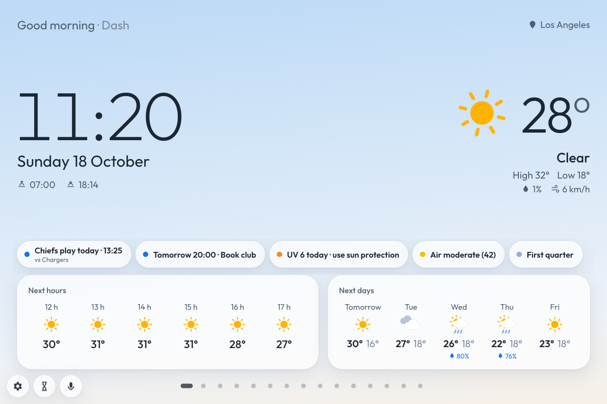 | 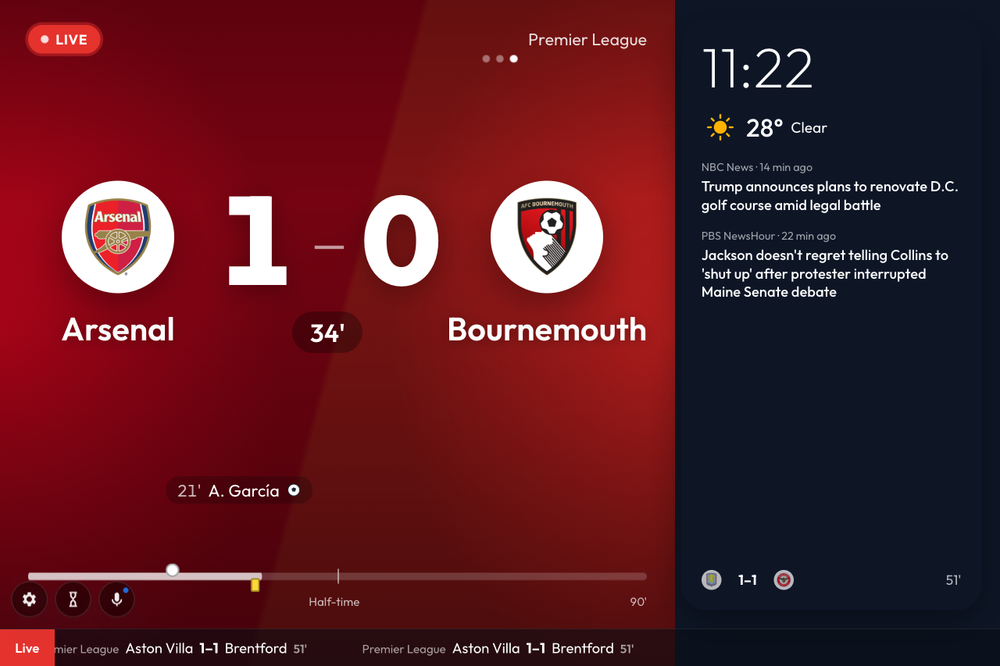 |
| 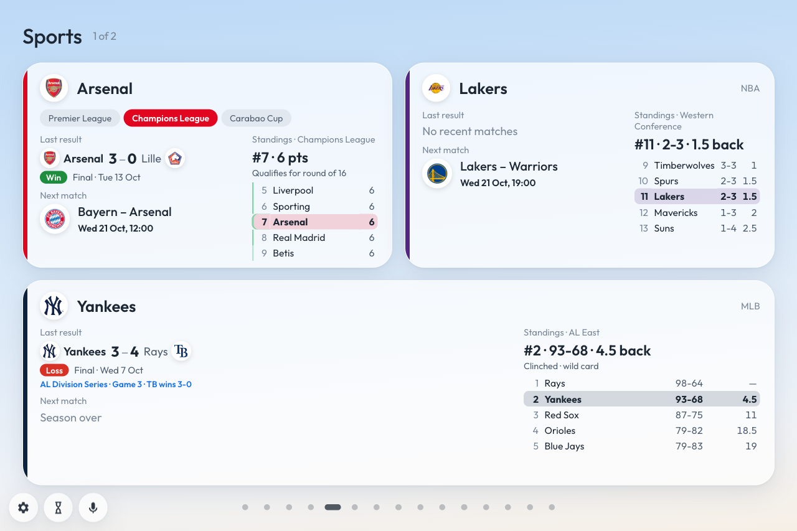 | 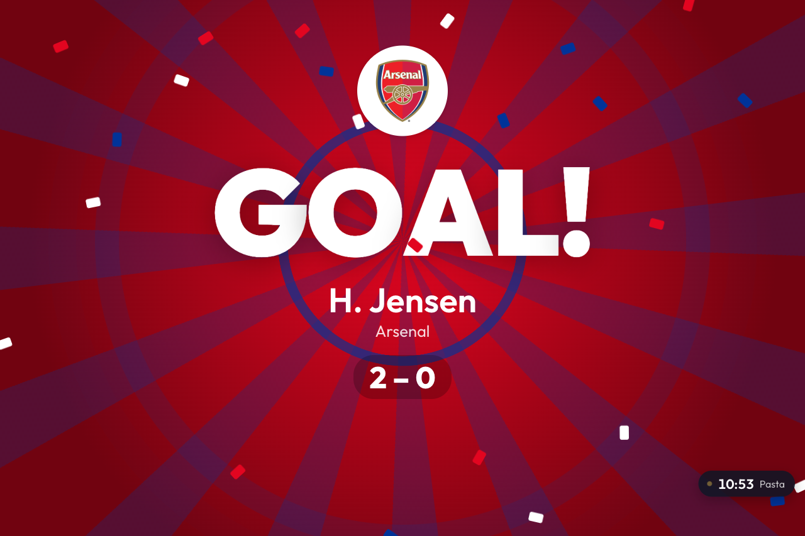 |
| 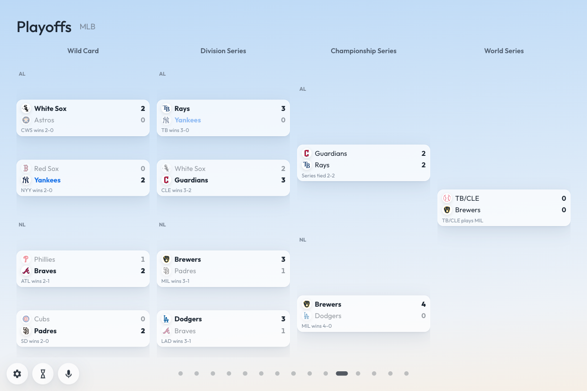 | 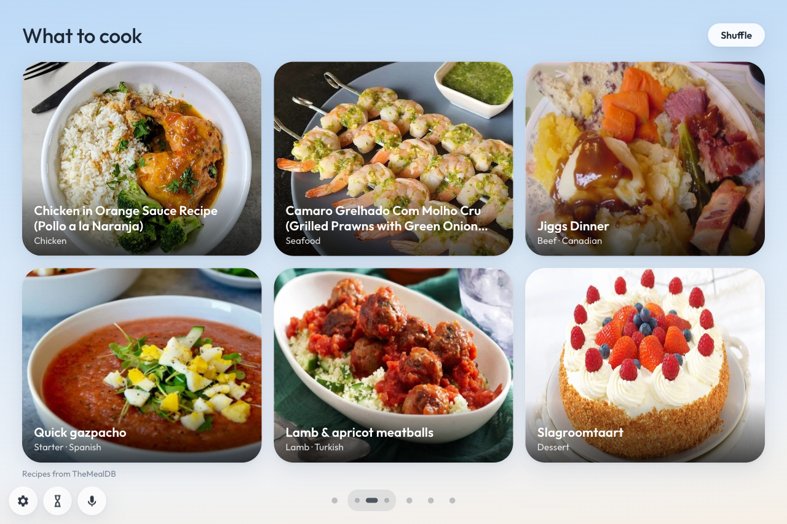 |
| 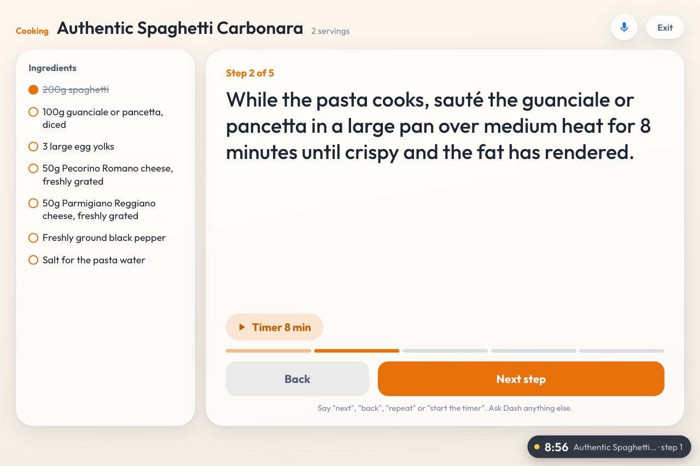 | 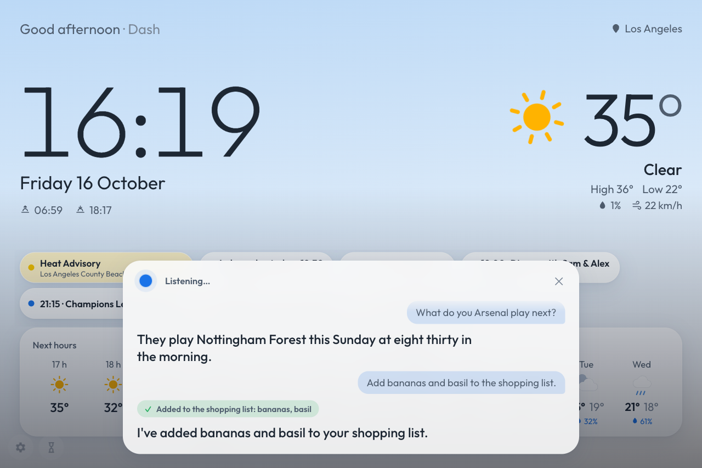 |
| 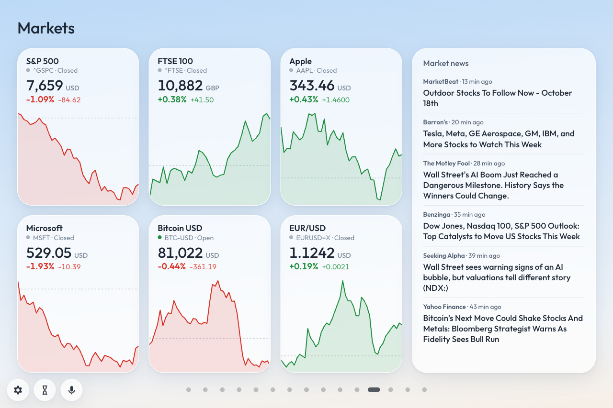 | 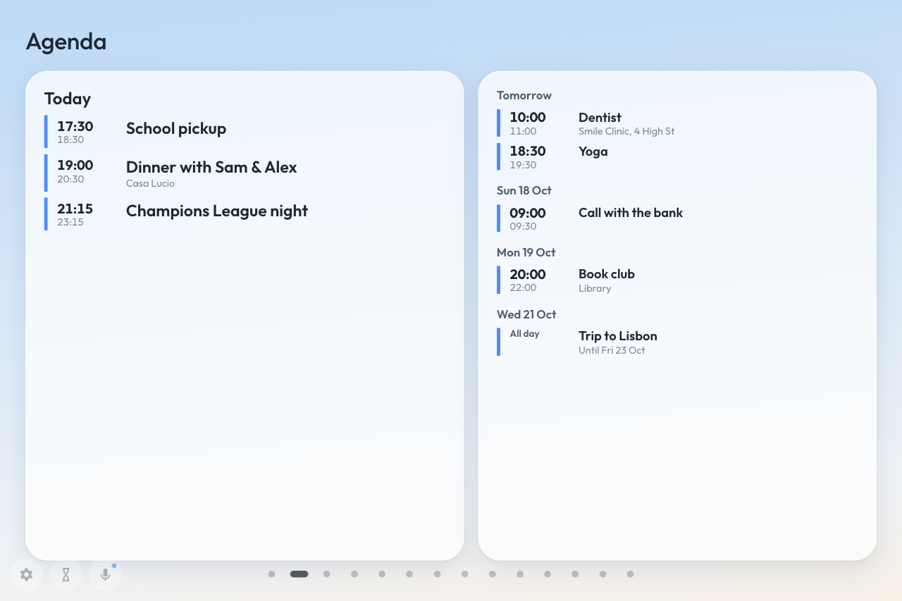 |
| 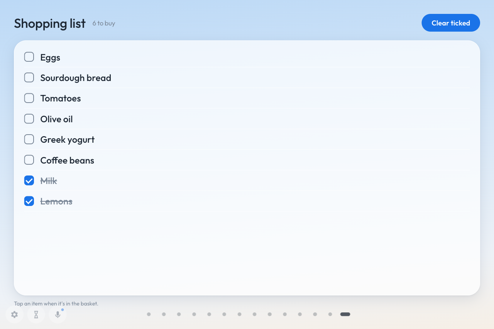 | 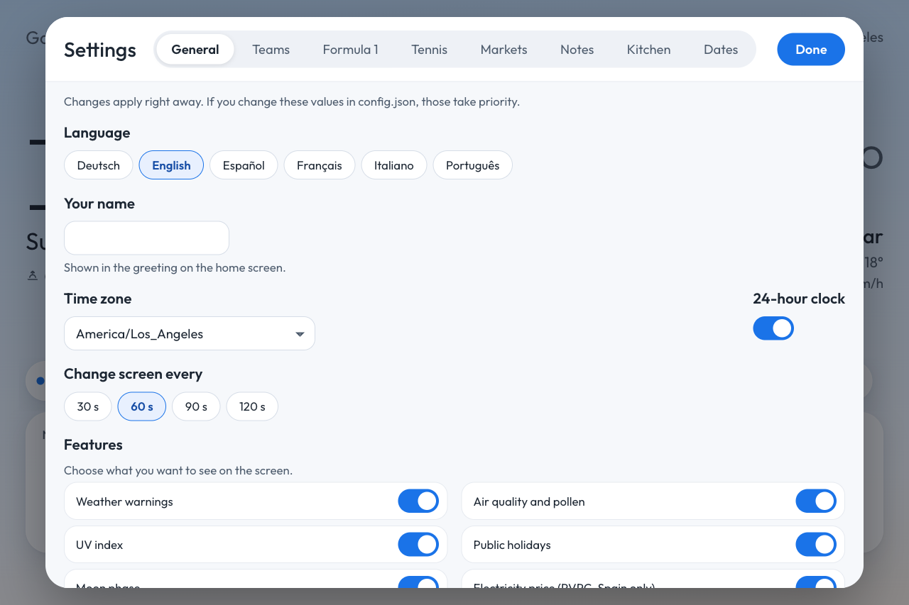 |

## What it shows

**Home.** Clock, weather with hourly and 5-day forecasts, and a Today strip with what matters now: weather warnings, holidays, your teams playing today, reminders and countdowns, rain ahead, UV, air quality, bin days, the cheapest electricity hour (Spain), the moon.

**Sports.** One card per team covering every competition it plays, plus F1 and tennis cards. A kickoff toast and a preview with line-ups before your match. Round results on match days, playoff brackets while knockouts are on (NBA, NHL, NFL, MLB, Champions League, domestic cups, national tournaments, EuroLeague). Follow whole leagues to see all their live games. When one of your teams plays, a full-screen board takes over, with a celebration when they score. A ticker of other live games runs along the bottom.

**Kitchen.** Six recipe ideas a day; tap one to see the ingredients, send the missing ones to the shopping list, and start cooking mode: one step at a time, timers where a step needs one, voice commands if the assistant is on. Paste any recipe link too. Kitchen timers and the shopping list are shared with your phone.

**Music.** What's playing on any of your Spotify devices, with controls and a speaker picker. Browse your playlists, search anything, open an artist, album, playlist or podcast page and play, shuffle or start from a song. Synced lyrics follow along while a song plays.

**Everyday.** Agenda from your calendars (Google, iCloud, Outlook, any iCal link), news with a hero story, sports news about your teams, markets with sparklines and market news, notes with reminders, countdowns, a quote of the day, a rain radar, a guest Wi-Fi QR code.

**"Hey Dash".** Ask anything out loud (it searches Google for current facts), add to the shopping list, set timers and alarms, save notes and reminders, start a recipe, play music, get a morning briefing, and have it remember things. Needs a Gemini API key; Gemini only runs while you're talking. See [docs/voice-assistant.md](docs/voice-assistant.md) for what it can do, what it costs and how your data is handled.

**The screen itself.** Panels rotate every minute (swipe or tap the dots; what's live comes right after Home), a dim clock at night, and optional wake on motion: the camera notices someone walking in and wakes the screen, processed locally with nothing stored or sent.

## Quick start

Needs Node.js 22+ (with nvm: `nvm install && nvm use`).

```bash
npm install
cp config.example.json config.json   # add your teams, location, language…
npm run build
npm start                            # http://localhost:3000
```

Open Settings (gear, bottom left, or `http://<device-ip>:3000/#settings` from your phone) to pick teams, leagues, symbols and features; changes apply immediately. `npm run demo` simulates live games so you can see the boards.

```json
"favorites": {
  "teams": [
    { "key": "arsenal", "league": "eng.1", "name": "Arsenal" },
    { "key": "lakers", "league": "nba", "name": "Los Angeles Lakers", "displayName": "Lakers" }
  ],
  "leagues": ["esp.1", "nba"]
}
```

Give a team its name and the league to look it up in; Dash finds every competition it plays. Football across Europe and the Americas, NBA, WNBA, EuroLeague, NFL, NHL, MLB, F1 and tennis are covered; the full list and every config key are in [docs/configuration.md](docs/configuration.md).

Optional extras, each a few lines of setup in that doc: the voice assistant (`GEMINI_API_KEY` in `.env`), Spotify (your own Spotify app's Client ID; Premium required), a Windows kiosk (`start.bat`, Edge policies for location, microphone and camera, auto-start at login).

## Phone and automations

Everything on screen has an HTTP endpoint: add to the shopping list from an iOS Shortcut, start a timer from Home Assistant, play music, download a backup. See [docs/api.md](docs/api.md). The API has no authentication: keep Dash on a trusted network.

## Built to be left alone

A source that rate-limits is paused and retried gently; a failed refresh keeps the last data; a supervisor restarts the server if it crashes or grows too big; the page reconnects, reloads after outages and after new builds, and the kiosk reopens the browser. Dash is polite to the free APIs it uses: competitions sleep until their next match day, finished days are never fetched twice, and ESPN requests are spaced out. Details in [docs/architecture.md](docs/architecture.md), with the data sources and known gaps.

## Development

```bash
npm run dev:demo               # server with auto-reload + Vite, simulated live games
npm test                       # unit tests (node:test)
npm run typecheck && npm run build
```

Express + Server-Sent Events on the server, Vite + vanilla TypeScript on the front. CI runs tests on Node 22 and 24. See [CONTRIBUTING.md](CONTRIBUTING.md) for adding a language, a competition or a data source, and [docs/architecture.md](docs/architecture.md) for the layout.

## License

[MIT](LICENSE)
